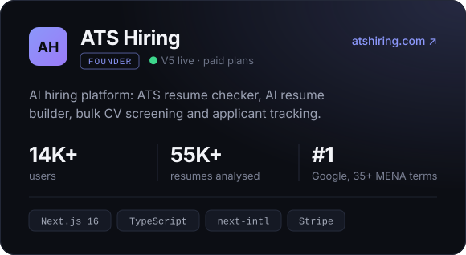
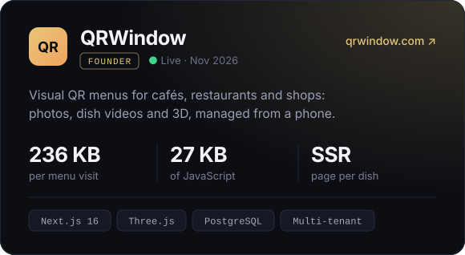
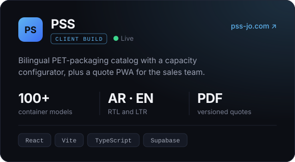
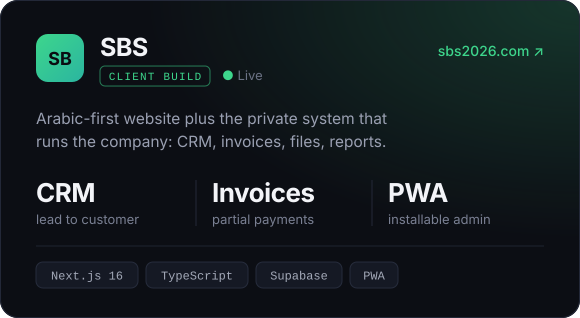
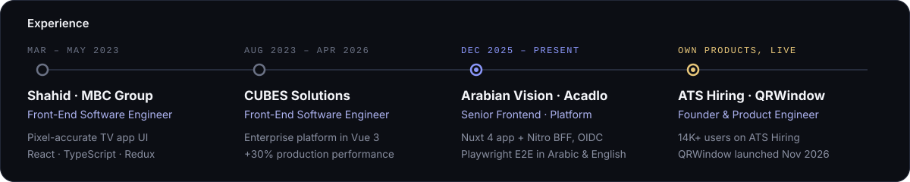
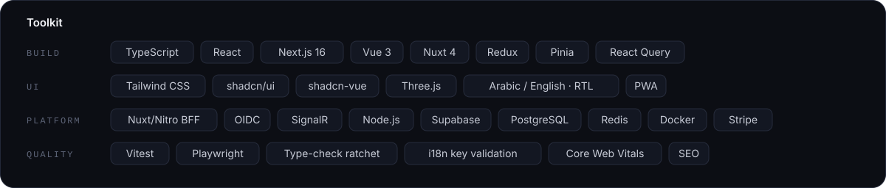

  <a href="https://www.ahmadq.dev/en"><b>ahmadq.dev</b></a>&nbsp;&nbsp;·&nbsp;&nbsp;
  <a href="https://www.linkedin.com/in/ahmad-qadoura/"><b>LinkedIn</b></a>&nbsp;&nbsp;·&nbsp;&nbsp;
  <a href="mailto:ahmad.h.qadoura@gmail.com"><b>Email</b></a>&nbsp;&nbsp;·&nbsp;&nbsp;
  <a href="https://www.ahmadq.dev/Ahmad_Qadoura_CV.pdf"><b>CV</b></a>

 

I'm a senior frontend engineer who builds bilingual, multi-tenant products, and a founder who ships his own. By day I own large parts of a Nuxt 4 education platform. The rest of the time I build and grow ATS Hiring and QRWindow, from the first component to pricing, payments and SEO.

Most of my production code lives in private repos, so here's the work, live:

 

  
  

  
  

  Full case studies → <a href="https://www.ahmadq.dev/en">ahmadq.dev</a>

 

### The ATS Hiring story

ATS Hiring started as a small resume checker inside another project. People kept coming back to it, so I took it seriously.

- **V1 → V5 in about 18 months**, built after work hours. V5 needed a major architecture refactor; it now serves both sides of hiring.
- **Recruiters** get a full workspace: jobs, pipelines, bulk screening that ranks up to 200 CVs per role, and talent search.
- **Job seekers** get ATS analysis, a resume builder, job matching and AI coaching, in Arabic and English.
- **Payments** were blocked for months, so I set up a UK company to get the infrastructure the product needed.
- **SEO** is a growth channel I built myself: #1 on Google in MENA for 35+ keywords.

 

 

### Engineering I care about

- **Performance budgets, not promises.** A QRWindow menu visit transfers 236 KB on slow 4G, with 27 KB of script, against roughly 480 KB for the framework version. Videos load only when a dish is opened, and wait for a tap on Save-Data or 2G.
- **Quality gates that hold the line.** A large Vitest suite, a type-check error ratchet, translation-key validation, and Playwright end-to-end tests that run in both Arabic and English against the live backend.
- **Multi-tenancy done properly.** Organisation trees (group → brand → branch), roles, and plan limits enforced in the database, with tests for tenant isolation.
- **Arabic-first, not translated later.** RTL and LTR from the first component, plus hreflang, structured data and a server-rendered page for every item.
- **Platform plumbing.** A Nuxt/Nitro backend-for-frontend with OIDC token refresh, tenant-scoped requests and SignalR notifications.

 

 

### On GitHub

| Repo | What it is |
| --- | --- |
| [**nova-ui**](https://github.com/AhmadQadourah/nova-ui) | Lightweight React + Tailwind component library |
| [**Celtis-POS**](https://github.com/AhmadQadourah/Celtis-POS) | Point-of-sale UI in Vue, focused on user flow and UX clarity |
| [**job-search-app**](https://github.com/AhmadQadourah/job-search-app) | Job search app built with Nuxt |

 

  Building something for MENA and want an engineer who also cares about the business? <a href="mailto:ahmad.h.qadoura@gmail.com">Let's talk.</a>

